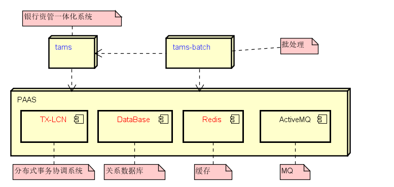
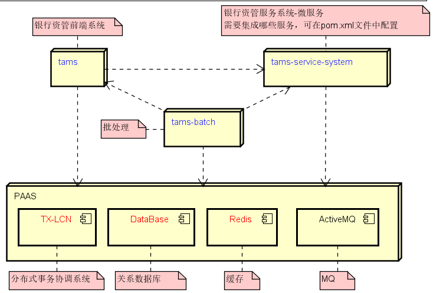
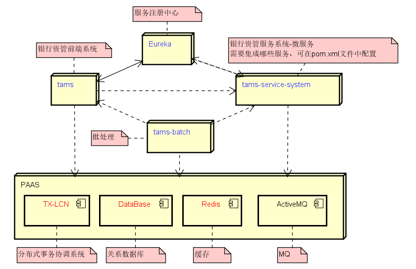

# 1.术语 #
- 前端：tams
- 后端: service-xxx
- 服务注册中心：Eureka

# 2.一体化部署 #


## 2.1.说明 ##
  将前端和后端打包在一起部署，即打包后的jar中含tams和service-xxx代码。

## 2.2.配置说明(这是产品默认的配置,即从Gitlab上下载后就是一体化版本) ##

- tams工程**集成**service-xxx工程
  
    tams/pom.xml中添加以下配置集成所有的服务端,若不需要所有的服务,则在microservice/tams-service-container/pom.xml中除去相应的依赖。
  ```  
  <dependency>
    <groupId>com.joyintech</groupId>
    <artifactId>tams-service-container</artifactId>
    <version>2.1.1</version>
  </dependency>
  ```

- tams调用服务端配置(调用service-xxx中的接口)
  
    tams/src/main/resources/application.yml中配置为一体化的调用方式,如果tams做了负载均衡，则下面的地址修改为负载均衡代理后的地址。
  ``` 
    application:
      loadbalance: false  #必须为false
      micorservice:
        contextPath:
          single: true    #tams工程中任何情况都为true
          commonService: http://127.0.0.1:${server.port}/tams
          basicDataService: http://127.0.0.1:${server.port}/tams
          documentService: http://127.0.0.1:${server.port}/tams
          entrustService: http://127.0.0.1:${server.port}/tams
          periodService: http://127.0.0.1:${server.port}/tams
          assetService: http://127.0.0.1:${server.port}/tams
          portfolioService: http://127.0.0.1:${server.port}/tams
          productService: http://127.0.0.1:${server.port}/tams
          quotaService: http://127.0.0.1:${server.port}/tams
          reportService: http://127.0.0.1:${server.port}/tams
          riskService: http://127.0.0.1:${server.port}/tams
          riskRdsService: http://127.0.0.1:${server.port}/tams
          riskInfService: http://127.0.0.1:${server.port}/tams
          settleService: http://127.0.0.1:${server.port}/tams
          tradeService: http://127.0.0.1:${server.port}/tams
          disclosureService: http://127.0.0.1:${server.port}/tams
          valuationService: http://127.0.0.1:${server.port}/tams
          chbService: http://127.0.0.1:${server.port}/tams
          chb3Service: http://127.0.0.1:${server.port}/tams
          svrcomService: http://127.0.0.1:${server.port}/tams
          pbcService: http://127.0.0.1:${server.port}/tams
          channelService: http://127.0.0.1:${server.port}/tams
          customerInterfService: http://127.0.0.1:${server.port}/tams
          tamsServer: http://127.0.0.1:${server.port}/tams
          investInterfService: http://127.0.0.1:${server.port}/tams
          adapterService: http://127.0.0.1:${server.port}/tams
  ``` 
# 3.前后端分开部署 #


## 3.1.说明 ##
  将前端和后端分开独立部署。前端启动tams，后端启动tams-service-system。tams-service-system默认包含所有的service-xxx，若不需要所有的服务,则在microservice/tams-service-container/pom.xml中除去相应的依赖。

## 3.2.配置说明 ##

- tams工程**去除**service-xxx工程

  tams/pom.xml中去掉tams-service-container的依赖。(注释或删除以下代码)
  ```
  <dependency>
    <groupId>com.joyintech</groupId>
    <artifactId>tams-service-container</artifactId>
    <version>2.1.1</version>
  </dependency>
  ```

- tams调用服务端配置(调用service-xxx中的接口)
  tams/src/main/resources/application.yml中配置为分开部署的方式,下面的ip和端口替换为tams-service-system部署的地址，如果tams-service-system做了负载均衡，则下面的地址修改为负载均衡代理后的地址。

  ```
    application:
      loadbalance: false    #必须为false
      micorservice:
        contextPath:
          single: true      #tams工程中任何情况都为true
          commonService: http://127.0.0.1:8114
          basicDataService: http://127.0.0.1:8114
          documentService: http://127.0.0.1:8114
          entrustService: http://127.0.0.1:8114
          periodService: http://127.0.0.1:8114
          assetService: http://127.0.0.1:8114
          portfolioService: http://127.0.0.1:8114
          productService: http://127.0.0.1:8114
          quotaService: http://127.0.0.1:8114
          reportService: http://127.0.0.1:8114
          riskService: http://127.0.0.1:8114
          riskRdsService: http://127.0.0.1:8114
          riskInfService: http://127.0.0.1:8114
          settleService: http://127.0.0.1:8114
          tradeService: http://127.0.0.1:8114
          disclosureService: http://127.0.0.1:8114
          valuationService: http://127.0.0.1:8114
          chbService: http://127.0.0.1:8114
          chb3Service: http://127.0.0.1:8114
          svrcomService: http://127.0.0.1:8114
          pbcService: http://127.0.0.1:8114
          channelService: http://127.0.0.1:8114 
          customerInterfService: http://127.0.0.1:8114
          tamsServer: http://127.0.0.1:8114
          investInterfService: http://127.0.0.1:8114
          adapterService: http://127.0.0.1:8114
  ```

# 4.微服务方式部署 #


## 4.1.说明 ##
  将前端和后端分开独立部署，并使用服务注册中心管理各个服务。前端启动tams，后端启动tams-service-system。tams-service-system默认包含所有的service-xxx，若不需要所有的服务,则在microservice/tams-service-container/pom.xml中除去相应的依赖。

## 4.2.配置说明 ##

- tams工程**去除**service-xxx工程

  tams/pom.xml中去掉tams-service-container的依赖。(注释或删除以下代码)
  ```
  <dependency>
    <groupId>com.joyintech</groupId>
    <artifactId>tams-service-container</artifactId>
    <version>2.1.1</version>
  </dependency>
  ```

- tams调用服务端配置(调用service-xxx中的接口)
  tams/src/main/resources/application.yml中配置为微服务部署的方式,下面的TamsMicroservice替换为tams-service-system部署时相对应的名字。(修改处:tams-service-system/src/main/resources/application.yml文件中spring.application.name的名字)

  ```
    application:
      loadbalance: true
      micorservice:
        contextPath:
          single: true
          commonService: http://TamsMicroservice
          basicDataService: http://TamsMicroservice
          documentService: http://TamsMicroservice
          entrustService: http://TamsMicroservice
          periodService: http://TamsMicroservice
          assetService: http://TamsMicroservice
          portfolioService: http://TamsMicroservice
          productService: http://TamsMicroservice
          quotaService: http://TamsMicroservice
          reportService: http://TamsMicroservice
          riskService: http://TamsMicroservice
          riskRdsService: http://TamsMicroservice
          riskInfService: http://TamsMicroservice
          settleService: http://TamsMicroservice
          tradeService: http://TamsMicroservice
          disclosureService: http://TamsMicroservice
          valuationService: http://TamsMicroservice
          chbService: http://TamsMicroservice
          chb3Service: http://TamsMicroservice
          svrcomService: http://TamsMicroservice
          pbcService: http://TamsMicroservice
          channelService: http://TamsMicroservice
          customerInterfService: http://TamsMicroservice
          tamsServer: http://TamsMicroservice
          investInterfService: http://TamsMicroservice
          adapterService: http://TamsMicroservice
  ```
